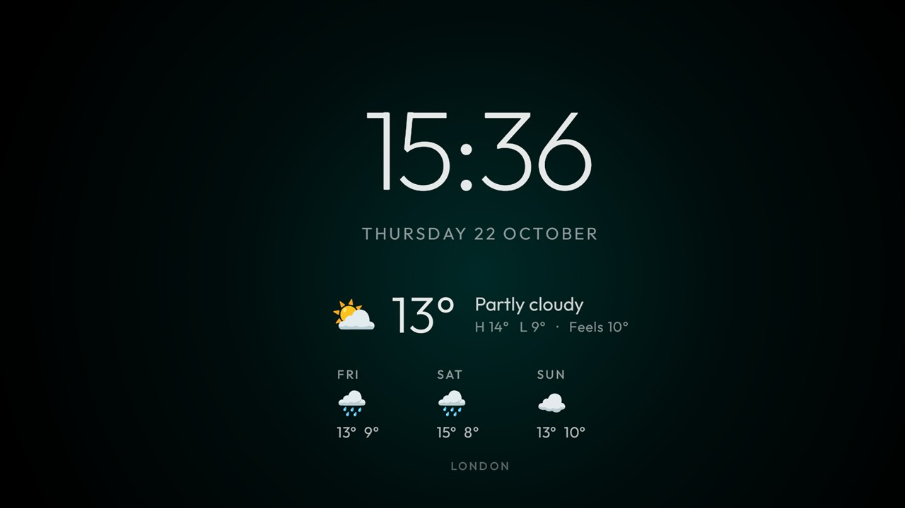

# Weather Clock

A screensaver for Android TV and Google TV: a large thin clock and the date, with the current weather, today's
high and low, "feels like" and the next three days underneath, centred on black over a slow ambient glow.
It is built to sit next to the [cleanyourtv](https://github.com/Gathin23/cleanyourtv) launcher, whose clock
screensaver it extends, but it works with any launcher.



- **No account, no key.** The forecast comes from [Open-Meteo](https://open-meteo.com/).
- **Automatic location** by default: the city of the TV's public IP address, looked up once a day
  ([ipwho.is](https://ipwho.is/), with [geojs.io](https://www.geojs.io/) as a fallback). Or pick a city by hand.
- **Light**: about 80 KB, plain Java, no libraries, no background service. It only runs while the screensaver is on,
  and refreshes the forecast every 30 minutes then.
- **No burn-in**: everything is nudged a little each minute, and the glow slowly changes colour.
- **Keeps working offline**: the last forecast is cached and shown at once. One older than 6 hours is hidden rather
  than shown as current.

Tested on a Chromecast with Google TV HD (Google TV 14) running the cleanyourtv launcher.

## Permissions and network

| | Why |
|---|---|
| `INTERNET` | The forecast from `api.open-meteo.com` (only the place's coordinates are sent), the city search from `geocoding-api.open-meteo.com`, and, in automatic mode, one lookup a day at `ipwho.is` or `get.geojs.io`, which see the TV's IP address as any website does |

Nothing else: no analytics, no ads, no other permission. If the TV routes its traffic through a VPN or a Tailscale
exit node, automatic location finds that location instead; pick your city by hand then.

## Install

You need adb on a computer on the same network as the TV
(Developer options > Wireless debugging > Pair device with pairing code, then `adb pair` and `adb connect`).

```sh
./gradlew assembleRelease         # JDK 17+, Android SDK platform 34; Windows: gradlew.bat
adb push app/build/outputs/apk/release/app-release.apk /data/local/tmp/weatherclock.apk
adb shell pm install -r /data/local/tmp/weatherclock.apk
adb shell settings put secure screensaver_components tv.weatherclock/.WeatherDream
```

(`adb install` works too, but on Android 14 it can hang waiting for an on-screen confirmation.) The last line makes
it the screensaver. It starts after the TV's idle timeout (10 minutes by default on the Chromecast).

To go back to the cleanyourtv clock:
`adb shell settings put secure screensaver_components com.gathin.tvhome/.ClockDream`.

## Settings

Open the **Weather Clock** tile:

- **Automatic** looks the city up from the IP address (the default).
- Type a city and press **Search** to pick one by hand.
- **Preview** shows the screensaver right away. The shell can't start a screensaver without root, so this is
  also the quickest way to see a change.

Or set it from a computer: `adb shell am start -n tv.weatherclock/.SettingsActivity --es city "Lisbon"`
(the first match), or `--ez auto true` for automatic.

## How it is built

| File | What it does |
|---|---|
| `WeatherDream.java` | The screensaver (`DreamService`) |
| `PreviewActivity.java` | The same scene as an ordinary screen, for Preview |
| `WeatherScene.java` | Layout, drift, glow and the 30-minute refresh. Adapted from the cleanyourtv launcher's `ClockScene` |
| `Weather.java` | Open-Meteo forecast and city search, IP location, cache, WMO weather codes as words and emoji |
| `SettingsActivity.java` | City search, Automatic and Preview |

## Credits

- The clock, date and glow are adapted from the [cleanyourtv](https://github.com/Gathin23/cleanyourtv) launcher
  (MIT, © 2026 Gathin).
- Weather data by [Open-Meteo](https://open-meteo.com/) (CC BY 4.0).
- [Outfit](https://github.com/Outfitio/Outfit-Fonts) typeface, SIL Open Font License 1.1 (`FONT-LICENSE-OFL.txt`).

MIT licence, see `LICENSE`.
